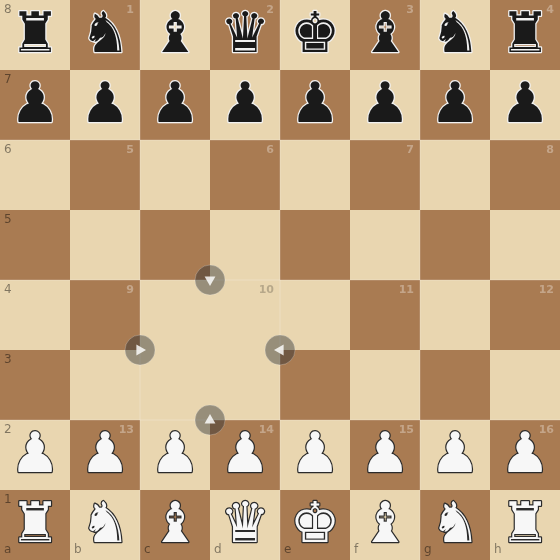

# Chess Variant — Sliding-Tile Chess

[](https://github.com/h4de5/chess-variant/actions/workflows/deploy.yml)

A chess variant played on a standard 8×8 board that is divided into a 4×4 grid of
2×2 tiles. One tile is missing — the **hole**. On your turn you either make a
normal chess move or slide an orthogonally adjacent tile into the hole.

**[Play it online](https://h4de5.github.io/chess-variant/)** — no build step, no
dependencies, plain HTML/CSS/JavaScript.



## The variant

- The board is a 4×4 grid of 2×2 tiles.
- One tile is missing (the hole). Its four squares do not exist.
- A turn is either a normal chess move or a slide of one tile into the hole.
- A slide moves the whole 2×2 tile, including all pieces on it (both colours).
- The vacated tile becomes the new hole.
- A slide never captures. It counts as a complete turn.
- No piece may enter or pass through the hole. A knight may jump over it, but
  must land on a real square.
- Check, checkmate, stalemate and draw detection include slides as legal actions.

The hole starts at tile 10 (files c–d, ranks 3–4). See
[`docs/sliding-tile-chess.md`](docs/sliding-tile-chess.md) for the full rules,
the design decisions and implementation notes.

## Features

- Local two-player mode and a simple computer opponent.
- Full chess rules: castling, en passant, promotion, 50-move rule, insufficient
  material and threefold repetition.
- Variant rules: promotion by slide, castling rights lost when king or rook is
  slid, en passant expires on a slide, and the repetition key includes the hole.
- Responsive canvas UI with slide arrows and a promotion chooser.
- No dependencies, no bundler, no build step.

## Controls

| Input | Action |
|---|---|
| Click/tap a piece | Select it; legal moves are highlighted |
| Click/tap a target square | Make the move |
| Click an arrow next to the hole | Slide the adjacent tile into the hole |
| "Neues Spiel" | Restart the current mode |
| "Menü" | Return to the mode menu |

The game UI is in German.

## Run locally

Open `index.html` directly in a browser, or serve the folder:

```bash
python3 -m http.server 8000
# http://localhost:8000
```

## Project structure

| File | Purpose |
|---|---|
| `index.html` | Entry point, canvas and overlay |
| `style.css` | Layout and overlay styling |
| `game.js` | Game logic, rules, AI, rendering and input (single IIFE) |
| `docs/sliding-tile-chess.md` | Rules, design decisions and implementation notes |
| `.github/workflows/deploy.yml` | Deploys the game to GitHub Pages on every push to `main` |

## Deployment

Every push to `main` runs the GitHub Actions workflow and publishes
`index.html`, `style.css` and `game.js` to GitHub Pages. The workflow uses the
official Pages actions and needs no secrets.

## Inspired by xkcd

The idea comes from [xkcd #3139](https://xkcd.com/3139/):

> The draw-by-repetition rule does a good job of keeping players from sliding a
> tile back and forth repeatedly, but the tiles definitely introduce some weird
> en passant and castling edge cases.

## License

[MIT](LICENSE) © h4de5
